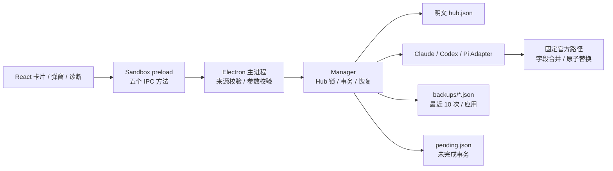

# MiSwitch 技术方案与核心实现

配置规范核对日期：**2026-10-12，Asia/Taipei**。这是已可运行的桌面核心实现，交付内容包括前后端、锁定的依赖、测试和构建脚本。按需求将应用范围限制为 Claude、ChatGPT、Pi 三个标签。

## 1. 架构与数据结构设计

### 1.1 明确适配对象

三个标签实际分别适配 **Claude Code、OpenAI Codex CLI、Pi Coding Agent**。Pi 按原 `badlogic/pi-mono`、现 `earendil-works/pi` 项目解释。若需求中的 Pi 指 Inflection 的 Pi，必须先获得该产品公开的配置协议，不能拿 Coding Agent 的文件结构套用。

Claude Desktop 的消费者聊天及 ChatGPT 消费者聊天没有在本方案中被假设为可通过 CLI 配置改变。Claude Desktop 的第三方推理配置也需要单独的官方适配器。这里使用用户允许的 Claude Code / Codex CLI 范围，不读写消费者客户端的私有数据库。参见 [Claude Code 鉴权与桌面边界](https://code.claude.com/docs/en/authentication)。

### 1.2 技术选型

采用 Electron + React + TypeScript：文件读写、锁、备份和验证集中在主进程；renderer 只处理 UI；sandbox preload 暴露五个受限方法。选择这套方案是为了复用 Node 的文件系统能力，并让 Fable 能在同一种语言中审查核心逻辑。

Electron 安装体积会大于 Tauri；若安装体积成为首要目标，可将同一 Adapter / Transaction 设计移植到 Tauri Rust 后端。当前交付已经包含可运行的 Electron 桌面应用，而不是只有一个浏览器演示。



核心目录：

```text
src/
  core/
    types.ts       Provider Zod Schema / IPC 类型
    paths.ts       官方路径与环境目录覆盖
    adapters.ts    每个工具的字段级映射
    files.ts       读写、fsync、链接检测、proper-lockfile
    manager.ts     CRUD、切换、备份、恢复、状态
  desktop/
    main.ts        单实例、BrowserWindow、IPC 主进程
    preload.ts     限定 Bridge
  ui/
    App.tsx        应用导航、卡片、编辑、备份与状态
    main.tsx       React 入口
    styles.css     现代卡片式界面
tests/
  manager.test.ts 真实临时文件的核心回归测试
scripts/
  build-desktop.mjs
  smoke-desktop.cjs
```

### 1.3 本地存储

配置数量较少，使用 JSON 足够；无需 SQLite、后台服务或云端账户。存储根目录是 `app.getPath('userData')/store`，由 Electron 按当前操作系统解析，避免自行拼接系统目录。

```text
<Electron userData>/store/
  hub.json
  hub.json.lock/             # 操作期间的跨进程锁目录
  pending.json              # 仅在切换/恢复尚未提交时存在
  backups/
    <UUID>.json
```

**不加密。** Hub 的 `apiKey`、备份原文和恢复日志都是普通 JSON。新建目录使用 `0700`，写入文件使用 `0600`；Windows 的 POSIX mode 不等于完整 ACL 设置，继承用户目录 ACL，发布前应在 Windows 上核对。已存在目录不会被强制更改权限。

实际 Schema 的执行定义在 `src/core/types.ts`，Hub 格式如下：

```json
{
  "version": 1,
  "providers": [
    {
      "id": "10000000-0000-4000-8000-000000000001",
      "app": "chatgpt",
      "name": "工作 Responses 网关",
      "mode": "api",
      "baseUrl": "https://gateway.example/v1",
      "model": "your-exact-model-id",
      "protocol": "openai-responses",
      "claudeAuth": "api-key",
      "loginProvider": "anthropic",
      "notes": "需要支持 Responses 和工具调用",
      "apiKey": "example-only-replace-me",
      "updatedAt": "2026-10-12T06:00:00.000Z"
    }
  ],
  "active": {
    "chatgpt": {
      "providerId": "10000000-0000-4000-8000-000000000001",
      "appliedAt": "2026-10-12T06:01:00.000Z",
      "fingerprint": "sha256-of-canonical-managed-fields",
      "hashes": {
        "/absolute/user/config/.codex/config.toml": "sha256-of-written-bytes"
      }
    }
  }
}
```

| 字段 | 类型与约束 | 作用 |
| --- | --- | --- |
| `version` | 固定 `1` | 为后续迁移留出版本标记 |
| `id` | UUID | 与供应商名称、模型名解耦 |
| `app` | `claude / chatgpt / pi` | 唯一支持的三个应用 |
| `mode` | `api / login` | API 配置或使用已有官方登录 |
| `name` | 非空，最大 100 字符 | 展示名称 |
| `baseUrl` | API 模式必需 | HTTPS；仅本机 loopback 允许 HTTP；不含账号、query、fragment |
| `apiKey` | API 模式必需 | 明文字面密钥；不得含空白或 `!`、`$` 起始的命令/环境表达式 |
| `model` | 非空，最大 200 字符 | 用户提供精确模型 ID；不猜测“最新模型” |
| `protocol` | 三种协议枚举 | Claude/Codex 再做应用级约束 |
| `claudeAuth` | `api-key / bearer` | Anthropic 官方 API 与 Bearer 网关区分 |
| `loginProvider` | Pi 登录模式使用 | `auth.json` 中已有 OAuth Provider ID |
| `notes` | 最大 2000 字符 | 用户备注 |
| `contextWindow` / `autoCompactTokenLimit` | 可选正整数，仅 Codex | 写入 `model_context_window` / `model_auto_compact_token_limit` |
| `updatedAt` / `appliedAt` | UTC ISO8601 | UI 按用户本地时区显示 |
| `active.*.fingerprint` | SHA-256 | 本工具管理字段的规范化 JSON 摘要；状态判定以此为准，CLI 自行重排文件不算漂移 |
| `active.*.hashes` | 路径 → SHA-256 | 上次写入的精确字节；仅用于提示“文件已被重排” |

向前端返回 `PublicProvider` 时剔除 `apiKey`，只返回 `hasKey`。编辑框留空保留旧密钥；已保存的密钥不会自动填回 renderer。修改当前 Provider 的元数据时清除 `active` 标记，提示再次启用，避免把未写入的编辑误显示为已生效。当前已写入的 Provider 必须先切换到另一组后才能删除。

备份 Schema：

```json
{
  "version": 1,
  "info": {
    "id": "20000000-0000-4000-8000-000000000002",
    "app": "claude",
    "createdAt": "2026-10-12T06:01:00.000Z",
    "files": ["settings.json"]
  },
  "entries": [
    {
      "path": "/absolute/user/config/.claude/settings.json",
      "before": "{\"permissions\":{\"deny\":[\"Read(secret)\"]}}\n",
      "after": "{...planned complete output...}\n"
    }
  ]
}
```

`before: null` 表示原文件不存在；恢复会删除这次创建的文件，保留目录。备份保存原始文本，恢复时能恢复格式、空格、换行和注释；普通切换中的 JSON / TOML 序列化保留字段含义，但不保证排版和注释保留。备份按应用各保留 10 次，核心构造参数可设为 1–100。单个备份文件损坏时会被跳过并在界面以警告列出文件名，不影响其他操作。

`pending.json` 使用 `{version,id,app,createdAt,entries}`，包含所有目标文件和 Hub 的前后原文。恢复只接受本次启动解析出的固定官方路径及 Hub 路径；目录覆盖改变后，不自动把旧备份迁移到新路径。

### 1.4 官方路径及读写映射

| 对象 | 默认路径 | API 写入 | 保留 / 不操作 |
| --- | --- | --- | --- |
| Claude Code | `~/.claude/settings.json` | `env.ANTHROPIC_BASE_URL`、API Key 或 Bearer token、`env.ANTHROPIC_MODEL`、`model` | 保留 hooks、permissions 和其他 env；不写 `~/.claude.json` 或私有登录数据 |
| Codex CLI | `~/.codex/config.toml` | 根 `model`、`model_provider`（官方模式移除）、可选上下文键和 `model_providers.custom` | 保留 MCP、projects、其他 Provider |
| Codex CLI | `~/.codex/auth.json` | 不改写；只加锁、备份、校验，判断 `requires_openai_auth` | 登录、续期交给 Codex；恢复备份时一并恢复 |
| Pi Coding Agent | `~/.pi/agent/models.json` | 唯一 Provider 的 `baseUrl`、`api`、`apiKey` 占位、`authHeader`、`models[].id` | 保留其他 Provider |
| Pi Coding Agent | `~/.pi/agent/auth.json` | 唯一 Provider 的 `{type:"api_key",key}` | 保留非 MiSwitch 条目和其他 OAuth 登录 |
| Pi Coding Agent | `~/.pi/agent/settings.json` | `defaultProvider`、`defaultModel` | 保留主题、thinking 等其他选项 |

目录解析依次使用相应的环境覆盖，再使用操作系统的 home：`CLAUDE_CONFIG_DIR`、`CODEX_HOME`、`PI_CODING_AGENT_DIR`。支持开头的 `~/` 展开，拒绝相对目录；不解析任意 shell 表达式。

#### Claude Code

API 模式示例：

```json
{
  "model": "your-anthropic-model-id",
  "env": {
    "ANTHROPIC_BASE_URL": "https://api.anthropic.com",
    "ANTHROPIC_API_KEY": "example-only-replace-me",
    "ANTHROPIC_MODEL": "your-anthropic-model-id"
  }
}
```

选择 Bearer 鉴权时写 `ANTHROPIC_AUTH_TOKEN`，不会同时留下 `ANTHROPIC_API_KEY`。切换时清除用户文件中的冲突键：旧 API Key、Bearer、Base URL、模型和默认模型路由、Bedrock / Vertex / Foundry 开关、`CLAUDE_CODE_OAUTH_TOKEN`。这些改动都有原文备份，其他环境变量保持原值。检测到 `apiKeyHelper` 时直接停止，避免无声删除用户的动态鉴权设置。

登录模式保留 CLI 自己管理的登录，仅清理本文件 API 路由并设置默认模型。它不意味着登录已完成，也不读取钥匙串里的账号信息。系统环境、项目级配置、profiles / federation、gateway session 和 managed settings 仍可能有更高优先级。

Claude Code 消费的是 Anthropic 协议，普通 `/v1/chat/completions` 端点不能直接使用；需要供应商提供 Anthropic Messages 接口或另行运行协议转换网关。官方依据：[设置文件与优先级](https://code.claude.com/docs/en/settings)、[环境变量](https://code.claude.com/docs/en/env-vars)、[鉴权优先级](https://code.claude.com/docs/en/authentication)。

#### Codex CLI / ChatGPT 标签

```toml
model = "your-responses-model-id"
model_provider = "custom"
model_context_window = 1000000          # 可选，Provider 设置了才写
model_auto_compact_token_limit = 900000 # 可选

[model_providers.custom]
name = "工作 Responses 网关"
base_url = "https://gateway.example/v1"
wire_api = "responses"
requires_openai_auth = true             # 仅当 auth.json 含登录凭据
experimental_bearer_token = "example-only-replace-me"
```

该模板与 cc-switch（`src-tauri/src/live/project/codex.rs`）一致，Provider ID 固定为 `custom`，两个工具可互相接管同一张表而不留下旧密钥：

- 第三方路由：`model_provider = "custom"`，密钥放在 `experimental_bearer_token`。`requires_openai_auth = true` 只在 `auth.json` 含登录凭据（`OPENAI_API_KEY`、`tokens.access_token`、`tokens.refresh_token` 或 `personal_access_token`）时写入，否则省略；判定逻辑对应 cc-switch 的 `codex_auth_has_credential_login_material`。
- 官方路由：移除 `model_provider`；`custom` 表保留但删除 `experimental_bearer_token` 与 `requires_openai_auth`，与 cc-switch 的 dormant 表一致。
- `model_context_window` 与 `model_auto_compact_token_limit` 是受管键：每次切换先清除，Provider 设置了才写回。Codex 对目录里没有的模型会打印“Model metadata not found”并使用回退元数据，这两个键只覆盖窗口与压缩阈值，不消除该警告。
- 旧版 `miswitch_<uuid>` 命名空间的表在切换时清理。

`auth.json` 与 `config.toml` 一起作为目标文件加锁、备份、回读校验，但 Adapter 原样返回它，事务对未变化的条目不执行写入；恢复历史备份时会一并恢复当时的 `auth.json`。登录状态变化（登录或登出）会改变 `requires_openai_auth` 的应有值，因此计入漂移判定；Codex 自行刷新 token 只改变字节，不算漂移。容器内用 Codex 0.162.1 验证：无论 `auth.json` 是 API Key 登录还是 ChatGPT 登录、无论是否设置 `requires_openai_auth`，请求都带 `experimental_bearer_token` 的值，因此保留官方登录不会让官方凭据泄漏到第三方端点。

Pi 的自定义 Provider ID 为 `miswitch_` + 去掉连字符的 UUID，避免覆盖官方内建 Provider；Codex 按 cc-switch 模板使用固定的 `custom`。切换时清理旧条目或旧 token，Hub 和备份仍保留对应历史。

使用 TOML 解析器，不通过正则替换。根 `profile` 选择器会被移除，`profiles` 表保留；否则所选 profile 可能覆盖根级模型和 Provider。用户再次以 `--profile` 或 CLI `-c` 启动，仍可能覆盖本次选择。检测到登录方式 / workspace 限制时停止，避免静默修改策略。

最新参考中 `wire_api` 为 `responses`；只支持 Chat Completions 的网关不能在此模式使用。为了“点击后普通 CLI 启动可读取”而使用已记录的 `experimental_bearer_token`，没有往 `auth.json` 写入第三方 API Key。

官方文档将该字段标注为 discouraged 并推荐 `env_key`，但 `env_key` 要求进程环境里真的存在该变量（容器内验证：仅写 `env_key` 而不设环境变量时 Codex 报 Missing environment variable），GUI 无法影响已打开的终端。cc-switch 同样选择 `experimental_bearer_token`，本工具沿用该模板；`http_headers` 虽可行，但没有必要。

登录模式移除 `model_provider` 键并清理本工具的 Provider 表，Codex 回到内建 `openai` 路由与自己的登录缓存。缓存可能在 `CODEX_HOME/auth.json`，也可能在操作系统凭据存储；是否存在文件不是登录状态的充分判断。并不管理多个 ChatGPT OAuth 账号，也不自行刷新 token。

官方依据：[配置参考](https://developers.openai.com/codex/config-reference)、[鉴权与凭据存储](https://developers.openai.com/codex/auth)。

#### Pi Coding Agent

`models.json`：

```json
{
  "providers": {
    "miswitch_30000000000040008000000000000003": {
      "baseUrl": "https://gateway.example/v1",
      "api": "openai-completions",
      "apiKey": "managed-by-miswitch:auth.json",
      "authHeader": true,
      "models": [{ "id": "your-model-id" }]
    }
  }
}
```

`auth.json`：

```json
{
  "miswitch_30000000000040008000000000000003": {
    "type": "api_key",
    "key": "example-only-replace-me"
  }
}
```

`settings.json`：

```json
{
  "defaultProvider": "miswitch_30000000000040008000000000000003",
  "defaultModel": "your-model-id"
}
```

每组 API 配置使用独立 Provider ID，防止内建 `openai` / `anthropic` 的 OAuth 凭据优先覆盖自定义密钥。只写当前选中的 MiSwitch 条目，不把所有供应商密钥铺到 Pi 的配置中。

`models.json` 中的 `apiKey` 是固定占位字面量：Pi 0.73 在自定义 Provider 缺少 `apiKey` 时拒绝加载整个 `models.json`，但发送请求时优先使用 `auth.json` 中同名条目的密钥（`model-registry.js` 的 `getApiKeyAndHeaders`）。真实密钥只写入 `auth.json`。该行为已由容器内真实 CLI 测试验证。

`api` 允许 `openai-completions`、`openai-responses`、`anthropic-messages`。模型仅设置官方 Schema 必需的 `id`，可选的 context、token limit、cost 不伪造；有特别兼容要求的供应商需要后续增加经过验证的能力字段。

Base URL 约定按 Pi 各客户端行为而定：`anthropic-messages` 会在 Base URL 后追加 `/v1/messages`，所以填写不带 `/v1` 的地址；两种 OpenAI 协议使用 SDK 的 `/v1` 约定，需要带 `/v1`。`authHeader: true` 使 Pi 在 Anthropic 协议下同时发送 `x-api-key` 与 `Authorization: Bearer`，容器测试确认两者均带正确密钥，兼容只接受其中一种的网关。

Pi 支持配置值表达式，包括环境插值和命令；本 UI 只收字面 API Key，拒绝会触发表达式的前缀。官方登录模式须指定已有 OAuth Provider ID，并验证对应条目的 `type === "oauth"`，然后只改默认模型与路由，保留登录原文。

Pi 的 `/model` 可重载模型配置，但启动默认值不等于已有会话立刻切换模型。恢复已有会话可能取回记录中的 Provider / Model。

官方依据：[模型与鉴权](https://github.com/earendil-works/pi/blob/main/packages/coding-agent/docs/models.md)、[设置](https://github.com/earendil-works/pi/blob/main/packages/coding-agent/docs/settings.md)、[模型 JSON Schema](https://pi.dev/schemas/models.schema.json)、[配置路径实现](https://github.com/earendil-works/pi/blob/main/packages/coding-agent/src/config.ts)、[auth 文件锁实现](https://github.com/earendil-works/pi/blob/main/packages/coding-agent/src/core/auth-storage.ts)。研究时远端 HEAD 为 `4270522473e677ddba7b093caa0064a3df51d459`；发布前应再对目标 CLI 版本复核。

## 2. 核心代码实现

### 2.1 切换事务

完整实现位于 `src/core/manager.ts`、`files.ts`，流程如下：

1. 校验 Provider UUID；取得 Hub 跨进程锁；若存在未完成恢复日志，先处理。
2. 从固定路径列表解析目标，不接受 renderer 传入路径；创建缺失目录，拒绝符号链接及异常文件。
3. 按固定排序取得目标文件锁。Pi `auth.json` 使用与官方一致的 `proper-lockfile` 约定。
4. 读取原文；JSON / TOML 解析失败时不覆盖；Adapter 在内存中生成所有结果。
5. 保存一组完整备份，再写 `pending.json`，包含目标及 Hub 的 before / after。
6. 各文件先写同目录唯一临时文件，`fsync`，比较当前内容是否仍等于 before，再 `rename`，同步目录。
7. Hub 最后写入，记录 Provider ID、时间和目标文件 hash。
8. 回读所有文件验证；删除并同步恢复日志后才报告成功。
9. 提交后清理每个应用超过保留数的备份；清理失败不把已完成切换误报为未完成。

核心调用入口：

```ts
import { Manager } from './src/core/manager';
import { resolvePaths } from './src/core/paths';

const manager = new Manager(resolvePaths('/absolute/miswitch/store'));

const added = await manager.save({
  app: 'chatgpt',
  name: '工作网关',
  mode: 'api',
  baseUrl: 'https://gateway.example/v1',
  apiKey: 'replace-with-real-key',
  model: 'your-exact-model-id',
  protocol: 'openai-responses'
});
const provider = added.providers.find(p => p.name === '工作网关')!;
const applied = await manager.activate(provider.id);
// applied 只含 hasKey，不回传 apiKey。
// 恢复前的当前文件也会自动备份。
await manager.restore(applied.backups[0].id);
```

备份和恢复是明文实现，不引入加密 API。`Manager` 可独立于 Electron 使用，生产目录解析由 Electron 主进程负责。

### 2.2 多文件失败与崩溃恢复

JSON/TOML 读取、备份失败都发生在目标覆写前。多文件写入中途失败时，按逆序恢复已写文件，只恢复仍完全等于本次 after 的内容。发现第三方内容时保留 `pending.json`，不盲目覆盖。

下次读取或修改 Hub 时会先恢复未完成事务：所有文件等于日志的 before 或 after 时自动回滚并删除日志。崩溃发生在写完所有文件但尚未删除日志时，也会保守回滚；用户可重新启用。

若任一文件已被第三方修改（既不是 before 也不是 after），`snapshot()` 仍正常返回，并在 `pending` 字段列出日志 ID、应用与冲突文件；所有写入操作（保存、删除、启用、恢复）在此期间被拒绝。界面提供“放弃日志并回退本工具的写入”：仅回退仍等于本次 after 的文件，被外部修改的文件原样保留，然后删除 `pending.json`。`pending.json` 自身无法解析时同样报告，并允许以其内容 SHA-256 作为确认 ID 直接丢弃；切换前的备份始终保留在历史备份中。没有强制覆盖外部修改的功能。

这是有日志的多文件事务，**不声称跨多个文件存在操作系统级原子提交**。另一 CLI 在写入间隙读取仍可能看到中间状态；最好先暂停目标会话。单文件原子 rename 避免读到半段 JSON，但并不能把三个 Pi 文件变成同时提交。

### 2.3 前端组件与调用边界

```text
App
 ├─ 应用导航：Claude / ChatGPT / Pi
 ├─ 本地状态：是否发现文件、hash 变化、刷新
 ├─ ProviderCard[]：当前写入 / 文件变化 / 重新启用
 ├─ ProviderEditor：名称、模式、URL、密钥、协议、模型、备注
 ├─ Modal：编辑或删除 / 恢复确认
 └─ 历史备份：时间、文件、恢复动作
```

`ProviderEditor` 使用原生 dialog，具有标题、焦点约束、Esc 关闭；字段使用 label。保存与启用期间禁用竞争动作。网络访问和文件访问均不在 React renderer 执行。

Bridge 仅暴露：

```ts
interface Bridge {
  snapshot(): Promise<Snapshot>;
  save(input: ProviderInput): Promise<Snapshot>;
  remove(id: string): Promise<Snapshot>;
  activate(id: string): Promise<Snapshot>;
  restore(id: string): Promise<Snapshot>;
}
```

主进程只接受本窗口、主 frame、固定本地页面来源；对所有 Provider 和 ID 再做校验。关闭 Node integration，开启 context isolation、sandbox、web security，禁止页面导航、新窗口及权限请求。CSP 禁止外部脚本、外部网络与对象加载。

密钥在新建表单提交时会经 IPC 到主进程；保存后的 list/snapshot 不带密钥。错误处理集中在 `src/core/errors.ts`：核心代码只以 `PublicError` 抛出静态中文提示，Zod 校验只转发 `superRefine` 产生的 `custom` 类型消息（同样是静态字符串），其余异常（JSON/TOML 解析错误、内建 Zod 消息、文件系统错误）一律替换为固定提示，以免回显密钥或文件内容。

### 2.4 状态含义

| 状态 | 判定 | 不应推出的结论 |
| --- | --- | --- |
| `none` | 没有本工具当前写入记录 | 不能推断目标没有登录 |
| `written` | 本工具管理的字段仍等于上次写入（按规范化 JSON 摘要比较） | 不能推断 API Key 有效、服务在线或运行中进程已换配置 |
| `written` + `reformatted` | 字节已变但管理字段未变，例如 CLI 自行保存了设置 | 不算漂移，界面只提示“文件已被重排” |
| `drift` | 管理字段变化、文件缺失、不可读取或无法解析 | 不自动重新覆盖外部修改 |

“刷新检测”手动重读本地文件。当前没有持续 file watcher，也没有无提示的自动同步；点击启用执行立即写入，适合让用户明确控制修改时机。

## 3. 避坑指南

| 问题 | 处理方式 |
| --- | --- |
| 修改另一个终端的环境变量 | 进程无法改变其他进程的环境。不要靠修改 `process.env` 宣称切换完成；本版把凭据写入 CLI 可读的配置，环境残留另行诊断。 |
| GUI 未继承 shell 导出的目录 | 从配置好环境的终端启动，或明确使用默认目录；GUI 只显示实际解析的绝对路径，不扫描或猜测私有路径。 |
| Claude Bearer / API Key / 云 Provider 同时存在 | 清理 user settings 中管理的冲突字段；报告本进程继承的变量；其他终端、profiles、gateway 与 managed 设置需用户核对 `/status`。 |
| Codex `profile` 覆盖根配置 | 移除根选择器，备份并保留 profiles 表；CLI 的 `--profile` 和 `-c` 仍优先。 |
| Pi OAuth 覆盖 API key | 自定义 API 配置使用独立 Provider ID，保持内建 OAuth 条目完整。 |
| MCP、权限、Hooks 丢失 | JSON/TOML 解析后仅修改约定字段，不用完整模板覆盖整个文件。`~/.claude.json` 保持由 Claude Code 管理。 |
| 文件格式损坏 | 拒绝覆写，提示修复；不能把 parse 异常直接展示，可能泄漏密钥。 |
| 同一配置被多进程写入 | 单实例 + Hub 锁 + 目标锁；非合作写入再做内容比较。不能消除比较与 rename 间的极小竞争窗口；CLI 最好暂停。 |
| Pi 多文件提交不原子 | 有 journal、逆序回滚和启动恢复；不承诺目标读取进程能同时看到三份更新。 |
| 同步工具产生符号链接 | 明确拒绝；使用实际目录。若未来支持链接，必须重新设计路径白名单与原子操作，不能默认跟随。 |
| Windows 文件占用 | 可能使 rename 失败；保留备份并回滚，释放目标占用后重试；没有杀进程或需要管理员的自动行为。 |
| 权限与 ACL | POSIX 新写文件 `0600`；现有文件的 mode/ACL/xattrs 不保证随替换原样保留。Windows 需独立验证目录 ACL。 |
| 官方登录多账号 / OAuth 过期 | 本版仅保留并使用已有凭据；登录、续期、登录限制和多账号切换交给官方 CLI。不要复制猜测的 refresh token 字段。 |
| Base URL 的 `/v1` 路径 | 用户输入供应商要求的完整 API base；不统一追加或删除 `/v1`，不自动探测接口。 |
| 网关“兼容”能力不足 | 核对实际协议、流式返回、工具调用、模型能力。配置写入通过不等于协议兼容验证通过。 |
| 有敏感信息的备份 | 按用户要求明文保留；备份比当前配置包含更多历史密钥，不公开提交，不默认上传或同步。 |
| 备份路径在迁移后不匹配 | 只恢复当前受支持的固定路径；需人工迁移。不能由 renderer 任意指定恢复目的地。 |
| 旧会话保持旧模型 | 重启 CLI 或在 CLI 中选模型；Pi resume 会恢复会话模型。没有通用可依赖的三款工具热刷新 API。 |

## 4. 验证与后续发布范围

已经验证核心逻辑、真实文件读写和实际 Electron 窗口 / preload IPC / React 表单流程。所有测试使用临时路径与合成密钥。

`npm run test:container`（`tests/container/`）在 Docker 内安装固定版本的 Claude Code 2.1.296、Codex CLI 0.162.1、Pi 0.73.1，用 `Manager` 写入配置后以 `claude -p`、`codex exec`、`pi -p` 请求容器内的模拟 API（`mock-server.mjs`，支持三种协议的流式与非流式响应），断言实际请求的路径、鉴权头与模型。2026-10-12 结果：Claude x-api-key 与 Bearer、Codex `experimental_bearer_token`、Pi `openai-completions` 与 `anthropic-messages` 共 5 项通过。附加实验：`experimental_bearer_token` 在 `auth.json` 为 API Key 登录或 ChatGPT 登录、`requires_openai_auth` 设或不设的四种组合下都优先生效；`http_headers` 也可行但未采用。

没有用真实密钥请求供应商，也没有修改真实 CLI 配置或验证真实账号；Windows/Linux 安装运行、完整 CLI 协议联调、安装包签名/公证与客户端版本矩阵需在发布前进行。当前没有将一个运行中的 OAuth 会话强制切为其他账号的能力。

参考文档描述的是核对时的规范，不意味着对未来 CLI 版本永久兼容。Adapter 分离的目的就是让版本变化集中在少量文件中，发布时应针对目标版本运行配置读回与鉴权测试。
