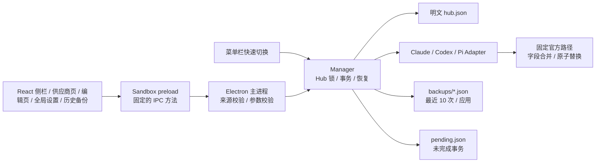

# Mi-Switch 技术方案与核心实现

> 应用显示名称为 Mi-Switch；仓库、内部标识与 Pi 的 `miswitch_` Provider 前缀保持 `miswitch` 不变。设置数据沿用旧版的位置（`app.setPath('userData', …)`）：打包版用过 `appData/MiSwitch`，开发版用过包名 `appData/miswitch`。在区分大小写的卷上这是两个文件夹，启动时选已有 `store/hub.json` 的那个（先 `MiSwitch`），都没有时用 `MiSwitch`；不移动任何数据。所以改名前后读取同一份 Hub 与备份。

配置规范核对日期：**2026-10-12，Asia/Taipei**。这是已可运行的桌面核心实现，交付内容包括前后端、锁定的依赖、测试和构建脚本。按需求将应用范围限制为 Claude、ChatGPT、Pi 三个标签。

## 1. 架构与数据结构设计

### 1.1 明确适配对象

三个标签实际分别适配 **Claude Code、OpenAI Codex CLI、Pi Coding Agent**。Pi 按原 `badlogic/pi-mono`、现 `earendil-works/pi` 项目解释。若需求中的 Pi 指 Inflection 的 Pi，必须先获得该产品公开的配置协议，不能拿 Coding Agent 的文件结构套用。

Claude Desktop 的消费者聊天及 ChatGPT 消费者聊天没有在本方案中被假设为可通过 CLI 配置改变。Claude Desktop 的第三方推理配置也需要单独的官方适配器。这里使用用户允许的 Claude Code / Codex CLI 范围，不读写消费者客户端的私有数据库。参见 [Claude Code 鉴权与桌面边界](https://code.claude.com/docs/en/authentication)。

### 1.2 技术选型

采用 Electron + React + TypeScript：文件读写、锁、备份和验证集中在主进程；renderer 只处理 UI；sandbox preload 只暴露固定的几个受限方法（见下方 Bridge）。选择这套方案是为了复用 Node 的文件系统能力，并让 Fable 能在同一种语言中审查核心逻辑。

Electron 安装体积会大于 Tauri；若安装体积成为首要目标，可将同一 Adapter / Transaction 设计移植到 Tauri Rust 后端。当前交付已经包含可运行的 Electron 桌面应用，而不是只有一个浏览器演示。



核心目录：

```text
src/
  core/
    types.ts       Provider Zod Schema / IPC 类型
    paths.ts       官方路径与环境目录覆盖
    adapters.ts    每个工具的字段级映射
    files.ts       读写、fsync、链接检测、proper-lockfile
    manager.ts     CRUD、切换、备份、恢复、状态
  desktop/
    main.ts        单实例、BrowserWindow、IPC 主进程
    preload.ts     限定 Bridge
  ui/
    App.tsx        应用导航、供应商列表、备份与状态
    ProviderEditor.tsx  预设选择与编辑面板（含配置文件）
    main.tsx       React 入口
    styles.css     设计 token、深浅色与布局
tests/
  manager.test.ts 真实临时文件的核心回归测试
scripts/
  build-desktop.mjs
  smoke-desktop.cjs
```

### 1.3 本地存储

配置数量较少，使用 JSON 足够；无需 SQLite、后台服务或云端账户。存储根目录是 `app.getPath('userData')/store`，由 Electron 按当前操作系统解析，避免自行拼接系统目录。

```text
<Electron userData>/store/
  hub.json
  hub.json.lock/             # 操作期间的跨进程锁目录
  pending.json              # 仅在切换/恢复尚未提交时存在
  backups/
    <UUID>.json
```

**不加密。** Hub 的 `apiKey`、备份原文和恢复日志都是普通 JSON。新建目录使用 `0700`，写入文件使用 `0600`；Windows 的 POSIX mode 不等于完整 ACL 设置，继承用户目录 ACL，发布前应在 Windows 上核对。已存在目录不会被强制更改权限。

实际 Schema 的执行定义在 `src/core/types.ts`，Hub 格式如下：

```json
{
  "version": 1,
  "providers": [
    {
      "id": "10000000-0000-4000-8000-000000000001",
      "app": "chatgpt",
      "name": "工作 Responses 网关",
      "mode": "api",
      "baseUrl": "https://gateway.example/v1",
      "model": "your-exact-model-id",
      "protocol": "openai-responses",
      "claudeAuth": "api-key",
      "loginProvider": "anthropic",
      "notes": "需要支持 Responses 和工具调用",
      "apiKey": "example-only-replace-me",
      "updatedAt": "2026-10-12T06:00:00.000Z"
    }
  ],
  "active": {
    "chatgpt": {
      "providerId": "10000000-0000-4000-8000-000000000001",
      "appliedAt": "2026-10-12T06:01:00.000Z",
      "rules": 2,
      "fingerprint": "sha256-of-canonical-managed-fields",
      "definition": "sha256-of-provider-fields-written",
      "hashes": {
        "/absolute/user/config/.codex/config.toml": "sha256-of-written-bytes"
      }
    }
  }
}
```

| 字段 | 类型与约束 | 作用 |
| --- | --- | --- |
| `version` | 固定 `1` | 为后续迁移留出版本标记 |
| `id` | UUID，Hub 内不得重复 | 与供应商名称、模型名解耦；读取到重复 ID 的 Hub 直接拒绝（写入全部暂停，界面显示原因，需手动备份后修正 `hub.json`） |
| `app` | `claude / chatgpt / pi` | 唯一支持的三个应用 |
| `mode` | `api / login` | API 配置或使用已有官方登录 |
| `name` | 非空，最大 100 字符 | 展示名称 |
| `baseUrl` | API 模式必需 | HTTPS；仅本机 loopback 允许 HTTP；不含账号、query、fragment |
| `apiKey` | API 模式必需 | 明文字面密钥；不得含空白或 `!`、`$` 起始的命令/环境表达式 |
| `model` | 非空，最大 200 字符 | 用户提供精确模型 ID；不猜测“最新模型” |
| `protocol` | 三种协议枚举 | Claude/Codex 再做应用级约束 |
| `claudeAuth` | `api-key / bearer` | Anthropic 官方 API 与 Bearer 网关区分 |
| `loginProvider` | Pi 登录模式使用 | Pi 中已有的 Provider ID：`auth.json` 中的条目（OAuth 或 API Key）或 `models.json` 中定义的 Provider |
| `notes` | 最大 2000 字符 | 用户备注 |
| `smallFastModel` / `sonnetModel` / `opusModel` / `fableModel` | 可选，最大 200 字符，仅 Claude API 模式 | 写入 `ANTHROPIC_DEFAULT_{HAIKU,SONNET,OPUS,FABLE}_MODEL`；haiku 路由同时是后台任务使用的模型。留空不写，切换时一律先清除 |
| `reasoningEffort` | 可选，`minimal / low / medium / high / xhigh`，仅 Codex | 设置时写入 `model_reasoning_effort`；不清除、不计入漂移判定，Codex 自己改写它属于用户选择 |
| `contextWindow` / `autoCompactTokenLimit` | 可选正整数，仅 Codex | 写入 `model_context_window` / `model_auto_compact_token_limit` |
| `updatedAt` / `appliedAt` | UTC ISO8601 | UI 按用户本地时区显示 |
| `imported` | 应用 → UTC ISO8601，可选 | 各应用本机配置的自动导入时间；有记录的应用不再自动导入 |
| `active.*.rules` | 正整数，可选 | 计算 `fingerprint` 与 `definition` 时使用的管理字段规则集；缺省为规则集 1（`722c119` 及之前） |
| `active.*.fingerprint` | SHA-256 | 本工具管理字段的规范化 JSON 摘要；状态判定以此为准，CLI 自行重排文件不算漂移 |
| `active.*.hashes` | 路径 → SHA-256 | 上次写入的精确字节；仅用于提示“文件已被重排” |
| `active.*.definition` | SHA-256，可选 | 写入时该应用与模式下会进入目标文件的 Provider 字段；与当前 Provider 不同即“写入后已编辑” |

向前端返回 `PublicProvider` 时剔除 `apiKey`，只返回 `hasKey`；`active` 只返回 `providerId` 与 `appliedAt`，各种摘要留在主进程。编辑框留空保留旧密钥；已保存的密钥不会自动填回 renderer。保存正在使用的 Provider 时，若会进入目标文件的字段有变化，`save()` 在同一操作中接着执行切换，文件立即更新；`save(input, { activate: true })`（界面的“保存并使用”）对任何 Provider 都这样做。切换失败时 Provider 已经保存，错误以“供应商已保存，但没有写入配置文件：”开头，界面据此关闭编辑页，避免重复保存出第二个 Provider；此时 `active` 记录保留，目标文件里仍是之前写入的设置，所以它仍然不能删除。状态检测比较 `definition` 与当前 Provider，有差异时摘要显示“配置文件仍是编辑前的版本”并提供“重新应用”，改回原值后提示自动消失。编辑保留 Provider 在列表中的位置，新增的排在最后。`definition` 只投影该应用与模式下 Adapter 实际写入的字段：Claude 为模型，API 模式另加 Base URL、密钥、鉴权头与四个别名路由；Codex 为模型、两个上下文键与推理强度，API 模式另加名称、Base URL 与密钥；Pi 为模型，API 模式另加 Provider ID、Base URL、协议与密钥，登录模式另加登录 Provider ID。因此只改备注、名称（Codex API 模式除外）或当前模式不使用的字段都不算编辑。`37e2673` 写入的记录没有 `definition`，那时编辑会清除记录，所以现存记录对应的必然是未编辑的 Provider，第一次编辑时用编辑前的 Provider 按记录自己的规则集补写。

**规则集。** 管理字段的范围可能随版本扩大（规则集 2 新增清理 fable 与旧 small/fast 路由，并改用上述投影）。每条 `active` 记录保存自己的 `rules`，状态检测与编辑判定都按该规则集计算，所以单纯升级不会把未改动的文件报成外部修改。旧规则集记录若在文件中仍有新规则集会清理的键，诊断提示“重新应用后按新规则清理”；重新应用后记录改用当前规则集。保存时，是否需要写入目标文件按当前规则集的投影比较修改前后的 Provider：没有变化（例如规则集 1 的 Codex 登录记录只改了名称）时，不切换，只把记录的 `definition` 按它自己的规则集更新为修改后的 Provider，因此不会被报告为“已编辑”，也不会改写文件。

**首次导入。** `importLive()` 是 `patchProvider()` 的逆向：读取各应用当前目标文件，生成一组 Provider 输入，再走同一 Schema 校验。没有参数时，只对没有 Provider、且 Hub 中没有 `imported` 记录的应用执行，界面首次载入时调用；指定应用时由空列表的“从本机配置文件导入”按钮触发，忽略记录。只要找到目标文件就写入 `imported`，所以删除导入的配置后不会再自动导入；完全没有配置文件的应用不记录，之后出现配置仍会导入。目标文件只读不写。

| 应用 | 导入规则 |
| --- | --- |
| Claude Code | `env` 有 `ANTHROPIC_AUTH_TOKEN` 或 `ANTHROPIC_API_KEY` 时为 API 模式（Base URL 缺省为官方地址，`AUTH_TOKEN` 对应 Bearer，haiku 或旧 small/fast 路由对应小型／快速模型，sonnet / opus / fable 路由一并导入）；否则为官方登录。模型取 `ANTHROPIC_MODEL` 或 `model`，都没有时用 Claude Code 的 `default` 别名。有 `apiKeyHelper` 或 Bedrock / Vertex / Foundry 开关时不导入 |
| Codex | 有 `model_provider` 时，对应表须有字面 `base_url` 与 `experimental_bearer_token`，且 `wire_api` 为 Responses，名称取表的 `name`；没有 `model_provider` 时为官方登录。上下文键一并导入。未设置 `model`、使用 `env_key` 或其他协议时不导入 |
| Pi | `settings.json` 的 `defaultProvider` 与 `defaultModel` 导入为“沿用已有 Provider”，名称取 `models.json` 中的 `name`；本工具自己的 `miswitch_*` 条目不导入 |

导入结果先在内存中用 `patchProvider()` 写回一次：若管理字段指纹与当前文件相同，说明重新写入不会改变任何管理字段，直接记为当前 `active`（`hashes` 为当前原文）；否则只导入不标记。待决日志存在时不导入。

**降级边界。** 旧版本的 Provider Schema 是 strict 的：保存过别名路由或 `reasoningEffort` 的 Hub 无法被不认识这些字段的旧版本打开（`smallFastModel` 从 `7090784`、其余从本次加入）（只读拒绝，不会覆写）。降级前先备份整个 store，再从 `hub.json` 删除这些字段。`active.*.rules`、备份的 `info.sequence` 不影响旧版本读取。

备份 Schema：

```json
{
  "version": 1,
  "info": {
    "id": "20000000-0000-4000-8000-000000000002",
    "app": "claude",
    "createdAt": "2026-10-12T06:01:00.000Z",
    "sequence": 12,
    "files": ["settings.json"]
  },
  "entries": [
    {
      "path": "/absolute/user/config/.claude/settings.json",
      "before": "{\"permissions\":{\"deny\":[\"Read(secret)\"]}}\n",
      "after": "{...planned complete output...}\n"
    }
  ]
}
```

`before: null` 表示原文件不存在；恢复会删除这次创建的文件，保留目录。备份保存原始文本，恢复时能恢复格式、空格、换行和注释；普通切换中的 JSON / TOML 序列化保留字段含义，但不保证排版和注释保留。备份按应用各保留 10 次，核心构造参数可设为 1–100。单个备份文件损坏时会被跳过并在界面以警告列出文件名，不影响其他操作。

**次序。** `info.sequence` 是所有应用共用的递增序号，在 Hub 锁内取现有最大值加一。列表、保留和去重都按序号判断新旧；`createdAt` 只有毫秒精度且受时钟回拨影响，仅用于显示和排列没有序号的旧备份（这些一律视为更旧）。清理保留数时，本次交易刚写出的备份永远不在淘汰候选内。

**列表缓存。** `Manager` 按文件版本（设备、inode、大小、mtime、ctime）缓存每个备份的解析与校验结果，未变化的文件不再读取。只有读取前后版本一致时才缓存，避免把读取途中被改写的内容绑到新版本；新写出的备份不直接种入缓存，由下一次列表实际读取。恢复时重新读取并校验选中的那一个。版本键是启发式：在 Windows 或时间精度粗的文件系统上尚未实测。

**略过相同备份。** 若本次各目标的 before 与该应用最新一份备份完全相同（按路径与原文计算摘要），不再写入新备份，避免反复切换到同一供应商挤掉保留配额中的不同历史；恢复日志照常写入。缓存中的摘要只用来提名候选：略过前重新读取并校验该候选，候选已变化、损坏或被删除时照常写入新备份。

备份必须包含该应用当前的完整目标文件集合，否则视为损坏并跳过；只接受明确列出的旧版集合（Codex 仅含 `config.toml` 的备份，恢复时不触碰 `auth.json`）。部分文件集合的恢复会让 Pi 的 `defaultProvider` 指向不存在的 Provider，因此在任何写入前就拒绝。

大小上限分两级：目标文件与 Hub 为 8 MiB（所有直接写 Hub 的操作——保存、删除、导入——都在替换前检查序列化后的大小，超出即拒绝并保留原 Hub）；备份与恢复日志聚合多份原文，上限 128 MiB。事务在写入任何文件前检查全部序列化输出：任一目标超过 8 MiB，或备份／日志超过 128 MiB，直接以静态错误停止，不修改任何文件。这样程序允许写出的内容都保证能被回读、回滚和恢复流程读取。恢复流程遇到无法读取的目标文件（超限、链接、非普通文件）一律视为冲突，不回退。

`pending.json` 使用 `{version,id,app,createdAt,entries}`，包含所有目标文件和 Hub 的前后原文。恢复只接受本次启动解析出的固定官方路径及 Hub 路径；目录覆盖改变后，不自动把旧备份迁移到新路径。

### 1.4 官方路径及读写映射

| 对象 | 默认路径 | API 写入 | 保留 / 不操作 |
| --- | --- | --- | --- |
| Claude Code | `~/.claude/settings.json` | `env.ANTHROPIC_BASE_URL`、API Key 或 Bearer token、`env.ANTHROPIC_MODEL`、可选 `env.ANTHROPIC_DEFAULT_HAIKU_MODEL`、`model` | 保留 hooks、permissions 和其他 env；不写 `~/.claude.json` 或私有登录数据 |
| Codex CLI | `~/.codex/config.toml` | 根 `model`、`model_provider`（官方模式移除）、可选上下文键和 `model_providers.custom` | 保留 MCP、projects、其他 Provider |
| Codex CLI | `~/.codex/auth.json` | 不改写；只加锁、备份、校验，判断 `requires_openai_auth` | 登录、续期交给 Codex；恢复备份时一并恢复 |
| Pi Coding Agent | `~/.pi/agent/models.json` | 唯一 Provider 的 `baseUrl`、`api`、`apiKey` 占位、`authHeader`、`models[].id` | 保留其他 Provider |
| Pi Coding Agent | `~/.pi/agent/auth.json` | 唯一 Provider 的 `{type:"api_key",key}` | 保留非 MiSwitch 条目和其他 OAuth 登录 |
| Pi Coding Agent | `~/.pi/agent/settings.json` | `defaultProvider`、`defaultModel` | 保留主题、thinking 等其他选项 |

目录解析依次使用相应的环境覆盖，再使用操作系统的 home：`CLAUDE_CONFIG_DIR`、`CODEX_HOME`、`PI_CODING_AGENT_DIR`。支持开头的 `~/` 展开，拒绝相对目录；不解析任意 shell 表达式。

#### Claude Code

API 模式示例：

```json
{
  "model": "your-anthropic-model-id",
  "env": {
    "ANTHROPIC_BASE_URL": "https://api.anthropic.com",
    "ANTHROPIC_API_KEY": "example-only-replace-me",
    "ANTHROPIC_MODEL": "your-anthropic-model-id"
  }
}
```

选择 Bearer 鉴权时写 `ANTHROPIC_AUTH_TOKEN`，不会同时留下 `ANTHROPIC_API_KEY`。切换时清除用户文件中的冲突键：旧 API Key、Bearer、Base URL、模型和各别名的模型路由（haiku / sonnet / opus / fable，以及 haiku 的旧名 `ANTHROPIC_SMALL_FAST_MODEL`，与 cc-switch 相同）、Bedrock / Vertex / Foundry 开关、`CLAUDE_CODE_OAUTH_TOKEN`。`CLAUDE_CODE_SUBAGENT_MODEL` 接受别名与完整模型 ID，属于用户偏好，保留不动；明确指定的子代理模型不随切换改变。这些改动都有原文备份，其他环境变量保持原值。检测到 `apiKeyHelper` 时直接停止，避免无声删除用户的动态鉴权设置。

网关通常只提供少数模型 ID。Claude Code 的后台任务和 haiku 别名走 `ANTHROPIC_DEFAULT_HAIKU_MODEL`，未设置时请求 Anthropic 默认的 Haiku ID（[模型配置](https://code.claude.com/docs/en/model-config)）。Provider 的“模型别名映射”中 Haiku 一栏写入该变量，Sonnet / Opus / Fable 各自写入对应路由；它们都是管理字段，计入漂移判定，留空则不写。编辑器提供“全部填为默认 Model”，适合只提供一个模型的网关。容器内用 Claude Code 2.1.296 验证：`claude -p --model haiku` 的主对话请求正是该字段的模型 ID。后台任务走同一路由的依据是官方文档与 2.1.296 可执行文件中的解析逻辑，容器测试没有动态触发后台任务。

登录模式保留 CLI 自己管理的登录，仅清理本文件 API 路由并设置默认模型。它不意味着登录已完成，也不读取钥匙串里的账号信息。系统环境、项目级配置、profiles / federation、gateway session 和 managed settings 仍可能有更高优先级。

Claude Code 消费的是 Anthropic 协议，普通 `/v1/chat/completions` 端点不能直接使用；需要供应商提供 Anthropic Messages 接口或另行运行协议转换网关。官方依据：[设置文件与优先级](https://code.claude.com/docs/en/settings)、[环境变量](https://code.claude.com/docs/en/env-vars)、[鉴权优先级](https://code.claude.com/docs/en/authentication)。

#### Codex CLI / ChatGPT 标签

```toml
model = "your-responses-model-id"
model_provider = "custom"
model_context_window = 1000000          # 可选，Provider 设置了才写
model_auto_compact_token_limit = 900000 # 可选

[model_providers.custom]
name = "工作 Responses 网关"
base_url = "https://gateway.example/v1"
wire_api = "responses"
requires_openai_auth = true             # 仅当 auth.json 含登录凭据
experimental_bearer_token = "example-only-replace-me"
```

该模板与 cc-switch（`src-tauri/src/live/project/codex.rs`）一致，Provider ID 固定为 `custom`，两个工具可互相接管同一张表而不留下旧密钥：

- 第三方路由：`model_provider = "custom"`，密钥放在 `experimental_bearer_token`。`requires_openai_auth = true` 只在 `auth.json` 含登录凭据（`OPENAI_API_KEY`、`tokens.access_token`、`tokens.refresh_token` 或 `personal_access_token`）时写入，否则省略；判定逻辑对应 cc-switch 的 `codex_auth_has_credential_login_material`。
- 官方路由：移除 `model_provider`；`custom` 表保留但删除 `experimental_bearer_token` 与 `requires_openai_auth`，与 cc-switch 的 dormant 表一致。
- `model_context_window` 与 `model_auto_compact_token_limit` 是受管键：每次切换先清除，Provider 设置了才写回。Codex 对目录里没有的模型会打印“Model metadata not found”并使用回退元数据，这两个键只覆盖窗口与压缩阈值，不消除该警告。
- 旧版 `miswitch_<uuid>` 命名空间的表在切换时清理。

`auth.json` 与 `config.toml` 一起作为目标文件加锁、备份、回读校验，但 Adapter 原样返回它，事务对未变化的条目不执行写入；恢复历史备份时会一并恢复当时的 `auth.json`。登录状态变化（登录或登出）会改变 `requires_openai_auth` 的应有值，因此计入漂移判定；Codex 自行刷新 token 只改变字节，不算漂移。容器内用 Codex 0.162.1 验证：无论 `auth.json` 是 API Key 登录还是 ChatGPT 登录、无论是否设置 `requires_openai_auth`，请求都带 `experimental_bearer_token` 的值，因此保留官方登录不会让官方凭据泄漏到第三方端点。

Pi 的自定义 Provider ID 为 `miswitch_` + 去掉连字符的 UUID，避免覆盖官方内建 Provider；Codex 按 cc-switch 模板使用固定的 `custom`。切换时清理旧条目或旧 token，Hub 和备份仍保留对应历史。

使用 TOML 解析器，不通过正则替换。根 `profile` 选择器会被移除，`profiles` 表保留；否则所选 profile 可能覆盖根级模型和 Provider。用户再次以 `--profile` 或 CLI `-c` 启动，仍可能覆盖本次选择。检测到登录方式 / workspace 限制时停止，避免静默修改策略。

最新参考中 `wire_api` 为 `responses`；只支持 Chat Completions 的网关不能在此模式使用。为了“点击后普通 CLI 启动可读取”而使用已记录的 `experimental_bearer_token`，没有往 `auth.json` 写入第三方 API Key。

官方文档将该字段标注为 discouraged 并推荐 `env_key`，但 `env_key` 要求进程环境里真的存在该变量（容器内验证：仅写 `env_key` 而不设环境变量时 Codex 报 Missing environment variable），GUI 无法影响已打开的终端。cc-switch 同样选择 `experimental_bearer_token`，本工具沿用该模板；`http_headers` 虽可行，但没有必要。

登录模式移除 `model_provider` 键并清理本工具的 Provider 表，Codex 回到内建 `openai` 路由与自己的登录缓存。缓存可能在 `CODEX_HOME/auth.json`，也可能在操作系统凭据存储；是否存在文件不是登录状态的充分判断。并不管理多个 ChatGPT OAuth 账号，也不自行刷新 token。

官方依据：[配置参考](https://developers.openai.com/codex/config-reference)、[鉴权与凭据存储](https://developers.openai.com/codex/auth)。

#### Pi Coding Agent

`models.json`：

```json
{
  "providers": {
    "miswitch_30000000000040008000000000000003": {
      "baseUrl": "https://gateway.example/v1",
      "api": "openai-completions",
      "apiKey": "managed-by-miswitch:auth.json",
      "authHeader": true,
      "models": [{ "id": "your-model-id" }]
    }
  }
}
```

`auth.json`：

```json
{
  "miswitch_30000000000040008000000000000003": {
    "type": "api_key",
    "key": "example-only-replace-me"
  }
}
```

`settings.json`：

```json
{
  "defaultProvider": "miswitch_30000000000040008000000000000003",
  "defaultModel": "your-model-id"
}
```

每组 API 配置使用独立 Provider ID，防止内建 `openai` / `anthropic` 的 OAuth 凭据优先覆盖自定义密钥。只写当前选中的 MiSwitch 条目，不把所有供应商密钥铺到 Pi 的配置中。

`models.json` 中的 `apiKey` 是固定占位字面量：Pi 0.73 在自定义 Provider 缺少 `apiKey` 时拒绝加载整个 `models.json`，但发送请求时优先使用 `auth.json` 中同名条目的密钥（`model-registry.js` 的 `getApiKeyAndHeaders`）。真实密钥只写入 `auth.json`。该行为已由容器内真实 CLI 测试验证。

`api` 允许 `openai-completions`、`openai-responses`、`anthropic-messages`。模型仅设置官方 Schema 必需的 `id`，可选的 context、token limit、cost 不伪造；有特别兼容要求的供应商需要后续增加经过验证的能力字段。

Base URL 约定按 Pi 各客户端行为而定：`anthropic-messages` 会在 Base URL 后追加 `/v1/messages`，所以填写不带 `/v1` 的地址；两种 OpenAI 协议使用 SDK 的 `/v1` 约定，需要带 `/v1`。`authHeader: true` 使 Pi 在 Anthropic 协议下同时发送 `x-api-key` 与 `Authorization: Bearer`，容器测试确认两者均带正确密钥，兼容只接受其中一种的网关。

Pi 支持配置值表达式，包括环境插值和命令；本 UI 只收字面 API Key，拒绝会触发表达式的前缀。登录模式（界面称“沿用 Pi 已有的 Provider”）指定一个已存在的 Provider ID：`auth.json` 中有该条目（OAuth 或 Pi 自己保存的 API Key），或 `models.json` 中定义了它（只认文件自身的条目；`__proto__`、`constructor` 这类继承属性名不算存在）。切换时只写 `defaultProvider` 与 `defaultModel`，该 Provider 的定义、覆盖项和凭据原样保留。找不到时拒绝切换。

Pi 的 `/model` 可重载模型配置，但启动默认值不等于已有会话立刻切换模型。恢复已有会话可能取回记录中的 Provider / Model。

官方依据：[模型与鉴权](https://github.com/earendil-works/pi/blob/main/packages/coding-agent/docs/models.md)、[设置](https://github.com/earendil-works/pi/blob/main/packages/coding-agent/docs/settings.md)、[模型 JSON Schema](https://pi.dev/schemas/models.schema.json)、[配置路径实现](https://github.com/earendil-works/pi/blob/main/packages/coding-agent/src/config.ts)、[auth 文件锁实现](https://github.com/earendil-works/pi/blob/main/packages/coding-agent/src/core/auth-storage.ts)。研究时远端 HEAD 为 `4270522473e677ddba7b093caa0064a3df51d459`；发布前应再对目标 CLI 版本复核。

## 2. 核心代码实现

### 2.1 切换事务

完整实现位于 `src/core/manager.ts`、`files.ts`，流程如下：

1. 校验 Provider UUID；取得 Hub 跨进程锁；若存在未完成恢复日志，先处理。
2. 从固定路径列表解析目标，不接受 renderer 传入路径；创建缺失目录，拒绝符号链接及异常文件。
3. 按固定排序取得目标文件锁。Pi `auth.json` 使用与官方一致的 `proper-lockfile` 约定。
4. 读取原文；JSON / TOML 解析失败时不覆盖；Adapter 在内存中生成所有结果。
5. 保存一组完整备份（与该应用最新备份的 before 完全相同、且重新读取确认后跳过），再写 `pending.json`，包含目标及 Hub 的 before / after。
6. 各文件先写同目录唯一临时文件，`fsync`，比较当前内容是否仍等于 before，再 `rename`，同步目录。
7. Hub 最后写入，记录 Provider ID、时间和目标文件 hash。
8. 回读所有文件验证；删除并同步恢复日志后才报告成功。
9. 提交后清理每个应用超过保留数的备份；清理失败不把已完成切换误报为未完成。

核心调用入口：

```ts
import { Manager } from './src/core/manager';
import { resolvePaths } from './src/core/paths';

const manager = new Manager(resolvePaths('/absolute/miswitch/store'));

const added = await manager.save({
  app: 'chatgpt',
  name: '工作网关',
  mode: 'api',
  baseUrl: 'https://gateway.example/v1',
  apiKey: 'replace-with-real-key',
  model: 'your-exact-model-id',
  protocol: 'openai-responses'
});
const provider = added.providers.find(p => p.name === '工作网关')!;
const applied = await manager.activate(provider.id);
// applied 只含 hasKey，不回传 apiKey。
// 恢复前的当前文件也会自动备份。
await manager.restore(applied.backups[0].id);
```

备份和恢复是明文实现，不引入加密 API。`Manager` 可独立于 Electron 使用，生产目录解析由 Electron 主进程负责。

### 2.2 多文件失败与崩溃恢复

JSON/TOML 读取、备份失败都发生在目标覆写前。多文件写入中途失败时，按逆序恢复已写文件，只恢复仍完全等于本次 after 的内容。发现第三方内容时保留 `pending.json`，不盲目覆盖。

下次读取或修改 Hub 时会先恢复未完成事务：所有文件等于日志的 before 或 after 时自动回滚并删除日志。崩溃发生在写完所有文件但尚未删除日志时，也会保守回滚；用户可重新应用。

若任一文件已被第三方修改（既不是 before 也不是 after），`snapshot()` 仍正常返回，并在 `pending` 字段列出日志 ID、应用与冲突文件；所有写入操作（保存、删除、切换、恢复、保存全局设置）在此期间被拒绝，菜单栏中的供应商也会停用。界面在顶部横幅列出冲突文件，提供“核对后放弃并回退”：仅回退仍等于本次 after 的文件，被外部修改的文件原样保留，然后删除 `pending.json`。`pending.json` 自身无法解析时同样报告，并允许以其内容 SHA-256 作为确认 ID 直接丢弃；切换前的备份始终保留在历史备份中。没有强制覆盖外部修改的功能。

这是有日志的多文件事务，**不声称跨多个文件存在操作系统级原子提交**。另一 CLI 在写入间隙读取仍可能看到中间状态；最好先暂停目标会话。单文件原子 rename 避免读到半段 JSON，但并不能把三个 Pi 文件变成同时提交。

### 2.3 前端组件与调用边界

```text
App
 ├─ 侧栏（macOS 设置风格的来源列表）
 │   ├─ 命令行工具：Claude Code / Codex / Pi，副标题为正在使用的供应商；配置文件被改过时显示琥珀色 ⚠
 │   ├─ 工具：历史备份（数量）、全局设置
 │   └─ 编辑供应商期间锁定，避免丢失未保存的输入
 ├─ 顶部横幅：浏览器预览提示、未完成切换（冲突文件 + 核对后放弃并回退）、备份解析警告
 ├─ 供应商页
 │   ├─ 工具栏：应用名、↻ 重新检测、＋ 添加供应商
 │   ├─ “正在使用”摘要卡：名称、白话状态、端点 / 模型 / 别名 / 密钥 / 文件、编辑…，异常时“重新应用”
 │   ├─ 类型筛选标签（API 与官方登录同时存在时出现）与“点 ▶ 切换，新会话生效”
 │   ├─ 供应商卡片：字母头像、名称与备注标签、端点、模型与附加信息；使用中显示“● 使用中”，其他显示 ▶；都有 ✎
 │   └─ 注意事项：诊断提示，可折叠
 ├─ ProviderEditor（整页）：添加时顶部为可搜索的预设标签；基本 / 连接 / 模型三组；模型可从供应商获取并点选；
 │   只读的“使用后的配置文件预览”；底栏为删除供应商、取消、保存 + 保存并使用（使用中的为“保存并应用”）
 ├─ GlobalSettings：分段选择应用；配置文件的全局部分（textarea），格式化（JSON）、重新读取、放弃修改、保存
 ├─ 历史备份：按应用筛选，逐条恢复
 ├─ Modal：删除 / 恢复 / 放弃未完成切换的确认，焦点默认在“取消”
 └─ 操作结果：底部提示，5 秒后消失，不推动版面
```

页面结构固定为工具栏、可滚动主体、（表单页）固定底栏，内容最宽 960 px 居中。编辑页取代供应商列表，而不是浮在上面的弹窗：长表单有完整高度，保存按钮始终可见。字段使用 label，保存与切换期间禁用竞争动作。网络访问和文件访问均不在 React renderer 执行。API 字段在登录模式下保持挂载但 `hidden` + `disabled`，因此模式来回切换不会丢失未保存的 URL 与 Key；禁用的 fieldset 不参与校验与 FormData，登录模式保存时不会带上密钥。预设只改写端点、协议、鉴权与模型字段，名称仅在为空或仍是上一个预设名时替换，已输入的 Key 与备注不动。

窗口重新获得焦点、或主进程发出 `miswitch:changed`（菜单栏切换后）时，renderer 静默重读 `snapshot()`；后台读取带序号，较早发出的结果不会覆盖之后操作的结果；首次载入的导入也参与同一序号。进行中的操作期间不发起后台读取，但会记下期间收到的变更通知，操作结束后补读一次，所以从菜单栏切换不会因为窗口正忙而被漏掉。全局设置页的读取同样带序号，并记录每份文字来自哪个应用：快速切换应用时，较早的回应不会覆盖较新的；保存只写入文字所属、且仍是当前所选的应用。

**菜单栏。** `src/desktop/tray.ts` 在菜单栏放一个模板图标（与应用图标同为“三轨”：三条轨道各代表一个 CLI，拨钮停在正在使用的供应商；PNG 在代码中生成，不打包图片文件）。菜单按应用分组列出全部供应商（单选项，正在使用的打勾），点一个即调用 `manager.activate()`，以系统通知报告结果，然后重建菜单并通知窗口刷新。存在未完成切换时供应商项停用。窗口中任何写入操作结束后也会重建菜单。macOS 上关闭窗口不退出应用，菜单中的“打开 Mi-Switch”重新打开窗口；其他平台关闭最后一个窗口即退出。

**色彩。** 以一个种子色（靛蓝 `#3e63dd`）为基础，参考三套设计语言：
- Material 3 的色彩角色：窗口、侧栏、面板都从种子色染出淡色调，不用纯灰；实心靛蓝只用于每页唯一的主按钮；“正在使用”摘要卡用主容器色（整页唯一的色块）；选中状态（侧栏、筛选标签、“使用中”、图标选择）一律用低彩度的选中容器色；▶ 用更淡的一阶。
- Apple 的深色模式：不是浅色反转，背景更暗、前景更亮，越上层越亮（窗口 `#15161b` → 侧栏 `#1b1d23` → 面板 `#20222a`）；深色模式的主按钮改为浅靛蓝底、深色字。
- Claude 的配色方法：多个色相保持同样低的饱和度。六个伴随色（陶土、石墨、梅紫、天蓝、石灰、矿绿）只用于侧栏小方块与字母头像。
状态色（绿、琥珀、红）只用于圆点、文字与“使用中”卡片，不做大面积色块。文字对比（含警告、错误文字与字母头像的首字）在浅色模式不低于 5.2:1，深色模式不低于 6.3:1；字母头像的字色是伴随色与正文色各约一半的混色。

**字体。** 界面与内文用系统字体（SF Pro / 苹方）；标题（品牌名、工具栏、“正在使用”的供应商名、对话框标题）用 Source Serif 4 搭配系统宋体，英文与中文同为衬线。Source Serif 4 为 OFL 授权，只打包拉丁子集（约 120 KB），中文由系统提供。端点、模型 ID、路径与配置文件用等宽字体。文字字级只有 11 / 12 / 13（界面）、17（标题）、22（正在使用）；字母头像的首字为 14–15 px，图标以 `font-size` 控制尺寸（13–22 px），不计入字级。

**图标与对齐。** 界面图标统一为 Lucide 线条图标；厂商标志来自 LobeHub Icons。两者在 `src/ui/marks.ts` 中以生成的 SVG 字符串内嵌（去掉 `<title>` 与内联样式，以符合 CSP 的 `style-src 'self'`），黑色单色标志使用 `currentColor`，因此在深色模式自动变白。工具栏、主体与底栏共用一条 960 px 栏；区块标题、工具栏标题与面板内的图标列同在栏内 16 px，名称与网址在其后 52 px，摘要卡的数值再后 60 px。所有用户文本设置 `overflow-wrap: anywhere` 或单行省略。

**供应商图标。** Provider 有可选字段 `icon`（`vendorIcons` 之一或 `letter`），只用于显示：不写入目标文件，也不进入 `definition`，所以修改图标不会被视为编辑、不会触发写入。未设置时由 `src/ui/vendor.ts` 自动决定：登录模式用该 CLI 的厂商；API 模式按 Base URL 主机名匹配厂商域名（域名本身或其子域名，`deepseek.com.evil.example` 不算）；都不匹配时显示名称首字，底色按名称取一个伴随色。测试确认每个内置预设的端点都能识别出厂商。

**应用图标。** `build/icon.svg` 是源文件（“三轨”，与菜单栏图标一致），`build/icon.png`（1024 px）由它生成，`electron-builder` 据此生成 macOS 的 icns。720 px 以下（含 840 px 最小窗口在 200% 缩放下的 420 px CSS 视口）侧栏改为顶部横排，卡片改为两行。提示的进场动画在 `prefers-reduced-motion` 下关闭。

Bridge 仅暴露：

```ts
interface Bridge {
  snapshot(): Promise<Snapshot>;
  save(input: ProviderInput, options?: { activate?: boolean }): Promise<Snapshot>;
  remove(id: string): Promise<Snapshot>;
  activate(id: string): Promise<Snapshot>;
  restore(id: string): Promise<Snapshot>;
  resolveJournal(id: string): Promise<Snapshot>;
  importLive(app?: AppId): Promise<Snapshot>;
  listModels(request: ModelListRequest): Promise<ModelList>;
  configView(request: ConfigViewRequest): Promise<ConfigView>;
  globalView(app: AppId): Promise<ConfigView>;
  saveGlobal(request: GlobalEdit): Promise<Snapshot>;
  onChanged(listener: () => void): () => void;
}
```

`onChanged` 订阅主进程的 `miswitch:changed` 事件（菜单栏切换后发出），返回取消订阅的函数；其余方法都是带来源校验的 `invoke`。

**配置文件与全局设置。** 与 cc-switch 现行的“关键字段”模型相同，每个应用的一个配置文件被分成两部分：供应商字段随切换写入，其余内容是该 CLI 的全局设置，对所有供应商生效：

| 应用 | 文件 | 供应商字段（随切换写入） |
| --- | --- | --- |
| Claude Code | `settings.json` | `model`，以及 `env` 中切换会清除的键（地址、密钥、模型与别名路由、云平台开关、`CLAUDE_CODE_OAUTH_TOKEN`） |
| Codex | `config.toml` | `model`、`model_provider`、`profile`、两个上下文键、`model_reasoning_effort`、`model_providers.custom` 与 `miswitch_*` 表 |
| Pi | `settings.json` | `defaultProvider`、`defaultModel` |

两部分分开编辑，避免一个表单同时改两种生效范围不同的东西：

- **全局设置页。** `globalView(app)` 读取本机文件，去掉供应商字段后返回文字与 `base`（全局部分的规范化摘要；TOML 日期与同样文字的字符串摘要不同）。返回的文字中，名称像凭据的字段（含 secret、password、authorization、bearer，或以 token、api_key、access_key、private_key 结尾，以及 `apiKeyHelper`）的字符串值一律换成占位文字，所以其他路由表的 `experimental_bearer_token`、MCP 服务的令牌、请求头等都不会到达 renderer；`base` 按未遮蔽的原值计算。`saveGlobal({ app, text, base })` 先解析文字：含有供应商字段时整体拒绝，并按名称列出（如 `model`、`ANTHROPIC_BASE_URL`、`model_providers.custom`）；再在锁内重读文件，全局部分摘要与 `base` 不符（读取后被其他程序修改）则拒绝，什么都不写；内容没有变化时不写。保存时，仍是占位文字的字段换回文件中同一位置的原值（该位置没有原值则拒绝）；否则取编辑后的全局部分，加上本机文件中现有的供应商字段，经事务写入（先备份完整文件集合、写恢复日志、回读校验）。当前写入记录的字节摘要同步更新，所以本工具自己的写入不会被报告为“文件已被重排”。
- **编辑页预览。** `configView({ app, draft, providerId })` 用切换时同一个 `patchProvider()` 把表单草稿投影到本机文件上，只读显示“使用后的配置文件预览”（展开时生成，字段变化后约 300 ms 刷新）。预览同样遮蔽所有凭据字段，只保留用户正在输入的密钥（renderer 本来就有）；已保存的密钥以占位文字代替。Claude 的 `apiKeyHelper` 会作为错误提示返回；云平台开关与切换时一样被清除，不报错。
- **格式。** JSON 以两空格缩进写回；`config.toml` 以 TOML 序列化写回，与切换相同，注释不保留，日期、时间值保持 TOML 类型（拆分与合并只复制普通对象，日期对象原样保留）。Codex 的 `auth.json` 不显示也不改写。
- **编辑器。** 使用等宽 `<textarea>`，JSON 提供“格式化”，另有“重新读取”与“放弃修改”。错误只显示文件名与行号，不回显解析器信息。没有使用 CodeMirror：它要注入内联样式，需要放宽 CSP 的 `style-src 'self'`。

**预设。** `src/core/presets.ts` 收录约 20 个精选供应商（官方、模型厂商、聚合平台），每个按应用给出 Base URL、协议、鉴权头与模型；端点与模型 ID 改编自 cc-switch 的 MIT 预设（见 `THIRD_PARTY_NOTICES.md`），移除了推广与邀请参数，不复制图标。Codex 只收原生支持 Responses 的供应商，因为 MiSwitch 没有把 Responses 转成 Chat Completions 的代理。添加页面顶部是可搜索的预设标签，“自定义”不填任何默认值；预设只填默认值，保存时照常校验。官网与“获取 API Key”链接仅限预设列表中的地址，由主进程的 `setWindowOpenHandler` 交给系统浏览器打开，其他新窗口一律拒绝。

**获取模型列表。** `listModels` 在主进程用 Electron `net.fetch`（遵循系统代理）请求供应商的模型列表：Base URL 以版本段结尾时请求 `{base}/models`，否则 `{base}/v1/models`；`/anthropic` 等兼容路径会再试去掉后缀的根路径。鉴权头与目标 CLI 一致：Claude 按所选鉴权头只发 `x-api-key` 或 Bearer，Pi 在 Anthropic 协议下两者都发，OpenAI 协议发 Bearer；Anthropic 协议另带 `anthropic-version`。Base URL 与保存时规则相同（HTTPS 或本机 HTTP）；不跟随重定向，避免密钥头被转到其他主机；10 秒超时，响应上限 4 MiB；错误只回传静态文字与 HTTP 状态码，不回显响应内容。编辑已有配置且未输入新密钥时，主进程用 Hub 中该配置的密钥，读完即释放 Hub 锁再发请求；但只在 Base URL（协议、主机、端口与路径，不计结尾斜杠）与保存时相同时才用，否则要求先填写适用于新地址的密钥，避免把已保存的密钥送到未保存的地址。结果显示为可筛选的列表（最多显示 300 个），点一个即填入“默认 Model”。

主进程只接受本窗口、主 frame、固定本地页面来源；对所有 Provider 和 ID 再做校验。关闭 Node integration，开启 context isolation、sandbox、web security，禁止页面导航与权限请求；新窗口只允许以系统浏览器打开预设列表中的官网与密钥页面。CSP 禁止外部脚本、外部网络与对象加载。

密钥在新建表单提交时会经 IPC 到主进程；保存后的 list/snapshot 不带密钥。错误处理集中在 `src/core/errors.ts`：核心代码只以 `PublicError` 抛出静态中文提示，Zod 校验只转发 `superRefine` 产生的 `custom` 类型消息（同样是静态字符串），其余异常（JSON/TOML 解析错误、内建 Zod 消息、文件系统错误）一律替换为固定提示，以免回显密钥或文件内容。

### 2.4 状态含义

| 状态 | 判定 | 不应推出的结论 |
| --- | --- | --- |
| `none` | 没有本工具当前写入记录 | 不能推断目标没有登录 |
| `written` | 本工具管理的字段仍等于上次写入（按规范化 JSON 摘要比较） | 不能推断 API Key 有效、服务在线或运行中进程已换配置 |
| `written` + `reformatted` | 字节已变但管理字段未变，例如 CLI 自行保存了设置 | 不算漂移，界面显示“已写入，新会话生效（文件被 CLI 重新排版过，设置未变）” |
| 旧版记录（无 `fingerprint`） | 仅按记录中存在的路径逐字节比较；记录缺少的新增目标不参与 | 缺少新字段不是外部修改；重新应用后升级为字段级判定 |
| `drift` | 管理字段变化、文件缺失、不可读取或无法解析；界面显示“配置文件被其他程序改过”与“重新应用” | 不自动重新覆盖外部修改 |

窗口重新获得焦点和菜单栏切换后自动重读本地文件，工具栏的 ↻ 可手动重读。没有持续 file watcher，也没有无提示的自动写入：只有 ▶、“保存并使用”、保存正在使用的供应商、“重新应用”和菜单栏选择会写入目标文件，让用户明确控制修改时机。

## 3. 避坑指南

| 问题 | 处理方式 |
| --- | --- |
| 修改另一个终端的环境变量 | 进程无法改变其他进程的环境。不要靠修改 `process.env` 宣称切换完成；本版把凭据写入 CLI 可读的配置，环境残留另行诊断。 |
| GUI 未继承 shell 导出的目录 | 从配置好环境的终端启动，或明确使用默认目录；GUI 只显示实际解析的绝对路径，不扫描或猜测私有路径。 |
| Claude Bearer / API Key / 云 Provider 同时存在 | 清理 user settings 中管理的冲突字段；报告本进程继承的变量；其他终端、profiles、gateway 与 managed 设置需用户核对 `/status`。 |
| Codex `profile` 覆盖根配置 | 移除根选择器，备份并保留 profiles 表；CLI 的 `--profile` 和 `-c` 仍优先。 |
| Pi OAuth 覆盖 API key | 自定义 API 配置使用独立 Provider ID，保持内建 OAuth 条目完整。 |
| MCP、权限、Hooks 丢失 | JSON/TOML 解析后仅修改约定字段，不用完整模板覆盖整个文件。`~/.claude.json` 保持由 Claude Code 管理。 |
| 文件格式损坏 | 拒绝覆写，提示修复；不能把 parse 异常直接展示，可能泄漏密钥。 |
| 同一配置被多进程写入 | 单实例 + Hub 锁 + 目标锁；非合作写入再做内容比较。不能消除比较与 rename 间的极小竞争窗口；CLI 最好暂停。 |
| Pi 多文件提交不原子 | 有 journal、逆序回滚和启动恢复；不承诺目标读取进程能同时看到三份更新。 |
| 同步工具产生符号链接 | 明确拒绝；使用实际目录。若未来支持链接，必须重新设计路径白名单与原子操作，不能默认跟随。 |
| Windows 文件占用 | 可能使 rename 失败；保留备份并回滚，释放目标占用后重试；没有杀进程或需要管理员的自动行为。 |
| 权限与 ACL | POSIX 新写文件 `0600`；现有文件的 mode/ACL/xattrs 不保证随替换原样保留。Windows 需独立验证目录 ACL。 |
| 官方登录多账号 / OAuth 过期 | 本版仅保留并使用已有凭据；登录、续期、登录限制和多账号切换交给官方 CLI。不要复制猜测的 refresh token 字段。 |
| Base URL 的 `/v1` 路径 | 用户输入供应商要求的完整 API base；不统一追加或删除 `/v1`，不自动探测接口。 |
| 网关“兼容”能力不足 | 核对实际协议、流式返回、工具调用、模型能力。配置写入通过不等于协议兼容验证通过。 |
| 有敏感信息的备份 | 按用户要求明文保留；备份比当前配置包含更多历史密钥，不公开提交，不默认上传或同步。 |
| 备份路径在迁移后不匹配 | 只恢复当前受支持的固定路径；需人工迁移。不能由 renderer 任意指定恢复目的地。 |
| 旧会话保持旧模型 | 重启 CLI 或在 CLI 中选模型；Pi resume 会恢复会话模型。没有通用可依赖的三款工具热刷新 API。 |

## 4. 验证与后续发布范围

已经验证核心逻辑、真实文件读写和实际 Electron 窗口 / preload IPC / React 表单流程。所有测试使用临时路径与合成密钥。

`npm run test:container`（`tests/container/`）在 Docker 内安装固定版本的 Claude Code 2.1.296、Codex CLI 0.162.1、Pi 0.73.1，用 `Manager` 写入配置后以 `claude -p`、`codex exec`、`pi -p` 请求容器内的模拟 API（`mock-server.mjs`，支持三种协议的流式与非流式响应），断言实际请求的路径、鉴权头与模型。2026-10-12 结果：Claude x-api-key、Bearer 与 haiku 别名走小型／快速模型（主对话请求，未触发后台任务），Codex `experimental_bearer_token` 与保留官方 `auth.json`，Pi `openai-completions` 与 `anthropic-messages`，共 7 项通过。附加实验：`experimental_bearer_token` 在 `auth.json` 为 API Key 登录或 ChatGPT 登录、`requires_openai_auth` 设或不设的四种组合下都优先生效；`http_headers` 也可行但未采用。

没有用真实密钥请求供应商，也没有修改真实 CLI 配置或验证真实账号；Windows/Linux 安装运行、完整 CLI 协议联调、Developer ID 签名/公证与客户端版本矩阵需在发布前进行。macOS arm64 dmg 已用 `npm run package` 生成（ad-hoc 签名，关闭 hardened runtime，因为它只在公证时需要，且 ad-hoc 签名下可能因库验证导致无法启动），并以临时 HOME 与 user-data 目录启动打包版验证：页面从 `app.asar` 载入，IPC 来源比对在含空白、中文与 `#` 的路径下通过。当前没有将一个运行中的 OAuth 会话强制切为其他账号的能力。

参考文档描述的是核对时的规范，不意味着对未来 CLI 版本永久兼容。Adapter 分离的目的就是让版本变化集中在少量文件中，发布时应针对目标版本运行配置读回与鉴权测试。
